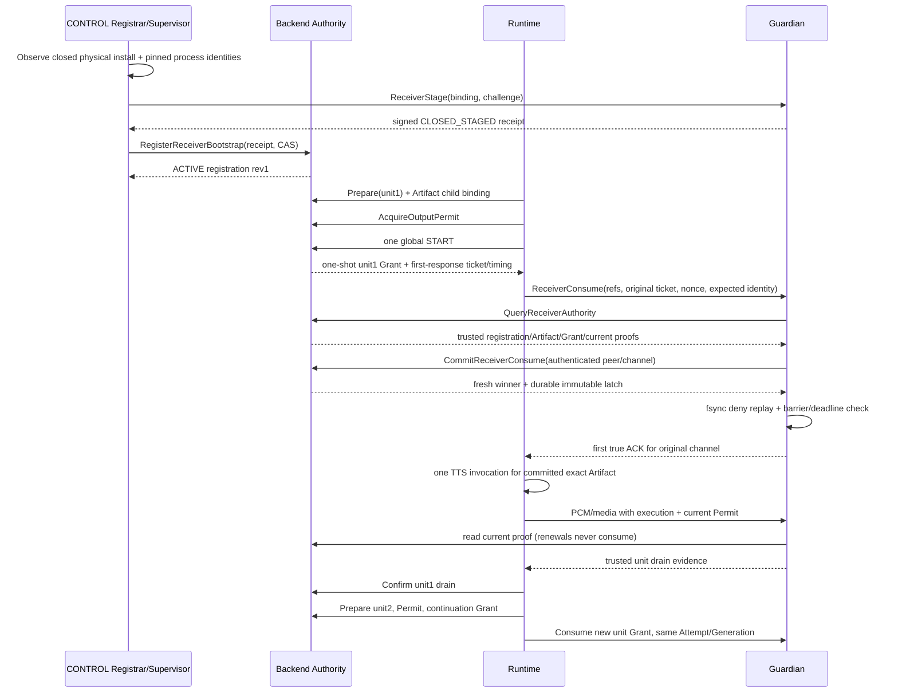

# Receiver Bootstrap / Authority / One-Time Consumption

**Candidate freeze after Agent4 DIRECTION ACCEPTED; final Agent4 ACK remains pending. No implementation authorization.** This closes the remaining seam in [Agent4 round2](https://github.com/leileiya1/AstraLive/pull/9#issuecomment-6227620414). The [direction request](https://github.com/leileiya1/AstraLive/pull/9#issuecomment-6227780199) and [Agent4 direction acceptance with required details](https://github.com/leileiya1/AstraLive/pull/9#issuecomment-6227939254) precede this freeze; acceptance is not final ACK. Existing whole-unit/Turn/Grant/fact/UNKNOWN rules are retained. Exact revision tuple is `(durable-live-2, receiver-1)`; both Backend-private and Guardian-private operations are listed in `receiver-protocol.json`, with closed objects in `schema.json`. No route is registered in production.

## Trust root and bootstrap ordering

CONTROL_REGISTRAR is a separately provisioned, narrow CONTROL principal for the Go Backend's trusted Session/process Registrar. In this frozen deployment profile the Registrar worker is co-located with the trusted Go Backend repository (with its own service principal); it is not an unspecified remote writer. Its typed internal `RegistrarRepository.IssueStageChallenge` uses DB time. A separately deployed Registrar needs an explicit transport contract before use. The Registrar includes the trusted host/deployment supervisory adapter that installs the Session Generation context and provisions process credentials. It is not Runtime, the LLM, a browser, a normal RUNTIME_JOURNAL token or a Guardian producer IPC token. Its identity/Room scopes, managed process identities, signing public keys and physical installation records are configured by the trusted deployment authority. No caller can enroll a process/key by sending a Stage/Consume JSON body.

The trusted supervisory part binds OS UID, PID creation identity/boot identity or the equivalent authenticated deployment instance to an individual process principal. Every Runtime/Guardian start receives a new process credential/incarnation; credentials are not reusable volume state. Guardian's Ed25519 keyId/public key is pinned through that CONTROL provisioning record before stage; the Stage response cannot introduce its own trusted key. Registrar validates Guardian peer identity, key ownership and its pinned signing key. `ReadReceiverPhysicalInstallation` at `/registrar/receiver-1/installations/read` is the closed, authenticated read interface for the host supervisory adapter. Its record is written only after the CONTROL-owned physical adapter independently observes installation/closed fence and managed process identity; a CONTROL request JSON object alone is not that record. It returns the full binding, installationRevision, observedByPrincipalId, guardianPrincipalId and closedFenceProofRef. Runtime has no access. Backend preflights this read outside SQL locks, then rechecks the mirrored immutable source/current revision in its short transaction; Guardian also reads it independently before stage, without requiring any Registration/Artifact/Permit/latch. Runtime cannot read Guardian private keys/state, CONTROL credentials, Backend authority credentials or publishing credentials.

Generation is the **existing physical Session Generation context**, independently allocated/installed by that trusted Session control adapter while output is closed. It is not a Run Epoch, GPU job ID, Worker epoch or a new binary-wire counter. Its namespace and integer limits are the existing Session/adapter's limits. A new v2 outer adapter must consume the CONTROL-installed context without silently assigning another Generation. No Generation/PTS/Credit field is added to the GPU wire. If that installation cannot be observed and matched independently, the Registrar refuses registration; Runtime reporting its current counter is insufficient.

Exact order:

1. Existing Room fence/term activation, physical Session/Provider Binding, command/Attempt/Turn/Utterance and active slot already exist. `JournalAccept` can accept the question and read-only LLM work; it grants no TTS. No bootstrap Artifact proof may yet be issued.
2. Registrar observes the current run epoch, lease owner/version, Room/outputBindingVersion and installed fence proof from durable truth. Its supervisory adapter installs a closed physical Generation for the exact Session/producer/Attempt/command/Turn/Utterance and records `physicalInstallProofRef`. It pins the current Runtime principal/runtimeIncarnation and Guardian process incarnation. A principal is never reused across physical process incarnations; producerIncarnation remains the separately pinned existing Session producer identity. Retiring a physical install makes its prior proof ineligible.
3. CONTROL calls `ReceiverStage` with the complete `ReceiverBootstrapBinding` plus a fresh persisted DB-time challenge. The internal Registrar repository binds challenge to descriptorHash, authorityIssuedAt/expiresAt and current run/lease; Runtime cannot mint it. Guardian independently matches that descriptor to its trusted provisioned process/install record, remains closed, and signs a `ReceiverStageReceipt`. It cannot stage a different context over an active unit. Receipt signature covers canonical UTF-8 of **every receipt field except signature**, including exact contract/receiver versions, bindingHash, challenge, Guardian principal/incarnation, keyId, installationRevision, DB-origin authorityIssuedAt/validUntil and CLOSED_STAGED. Guardian copies the trusted challenge times rather than claiming its wall clock as DB time. No media or TTS right exists. The receipt is short-lived (at most1second), and the authority uses its own time.
4. Registrar verifies the receipt against the pre-pinned key/process, exact challenge/descriptor, physical installation record, required output fence proof and live Provider Binding. `RegisterReceiverBootstrap` executes a short Backend transaction: run/lease/slot/Attempt and producer must still match; expectedRunRevision, expectedLeaseVersion and expectedRegistrationRevision=0 must match. It inserts ACTIVE registration at revision1. Auth/Stop/epoch/expiry checks precede duplicate lookup. An identical current registration retry is readback only; different descriptor/stageReceipt or revoked context conflicts. The Registrar owns the repository and can inspect its registration by ID after an ACK loss; it must not reinstall or change identity merely because an HTTP response was lost.
5. Only now may `JournalPrepareAnswer` persist unit1. The same transaction commits the immutable Artifact, original/alias key and receipt, actual answer/fact/snapshot hashes, answer CAS, and `ReceiverArtifactRegistration` linking the exact Artifact/hash/answer/sequence to this registrationHash. First FactObservation uses the registered Generation, never a future consumption latch. Later units append their own child bindings; parent physical registration stays immutable.
6. First `AcquireOutputPermit`, then the single `JournalStart` operate on that ACTIVE registration and child binding. The Backend resolves Generation and Guardian incarnation from stored registration, not request extras. All the existing current lease/epoch/slot/Binding/product/fact/Stop checks remain. Initial Permit/FactObservation/Grant references are now rooted before START, without a circular dependency on consumption.

The bootstrap ID and registrationHash are stable. Parent binding is immutable; ACTIVE/REVOKED state and revision are separate CAS projections. `expectedLeaseVersion` is transaction metadata on registration, not an immutable physical identity: later valid lease renewal in the same term does not require a new Generation. Room outputBindingVersion and runEpoch are immutable identity and must still match. The standalone Grant/Permit/Observation/ExecutionBinding definitions are reachable through the private Authority request/response closure; they are not merely trace objects.

## Private interface and permission matrix

All operations require exact route + exact contractRevision + receiverRevision + stored run/command revision. There is no fallback to `/guardian/v1` or durable-live-1. AF_UNIX IPC uses protected socket directories, peer process credentials and per-process scoped credentials; a token alone in a JSON field does not establish identity. Backend Authority uses authenticated private service transport with distinct OUTPUT_GUARDIAN process credentials. Cross-Room/run access fails before data/receipt lookup. Unknown/extra/duplicate JSON fields and non-integer identities are rejected. Control bodies≤256KiB, decoded media IPC bodies bounded by the existing9MiB envelope (schema base64 limit and transport checks enforce it), and one active media unit plus one prepared lookahead remain.

| Operation | Caller → owner | Permission / result |
| --- | --- | --- |
| ReadReceiverPhysicalInstallation | CONTROL_REGISTRAR or own OUTPUT_GUARDIAN → trusted Registrar/Supervisor | Read independently observed physical context and closed fence provenance; never self-register, never depend on future Permit or latch |
| RegisterReceiverBootstrap | CONTROL_REGISTRAR → Backend | Only trusted Registrar writes bootstrap rows; verify pinned stage/process/install evidence plus short-transaction CAS. No START grant |
| RevokeReceiverBootstrap | CONTROL_REGISTRAR → Backend | Revoke exact registration/revision with audit reason; automatic Stop/epoch/session/binding/peer revocations use the same code/lock order |
| QueryReceiverAuthority | OUTPUT_GUARDIAN → Backend | Only exact bound Guardian process, tenant/owner/Room; read immutable registration/child/Artifact/Grant, current Permit/Observation and knowledge state. No latch write or execution authorization |
| CommitReceiverConsume | OUTPUT_GUARDIAN → Backend | Narrow permission for **Backend** to create one latch. No CONTROL/lease/content/fact/START mutation permission for Guardian |
| QueryReceiverConsumption | OUTPUT_GUARDIAN → Backend | Same registered Guardian service/Room may inspect historical receiptId/knowledge state after proof expiry/process replacement. No Artifact text, Grant, executable binding or true response |
| ReceiverStage | CONTROL_REGISTRAR → Guardian | Closed physical install and signed readiness only, never publisher bind or TTS |
| ReceiverConsume | registered Runtime → Guardian | Exact references/expected identity comparisons; peer identity comes from transport. Guardian independently verifies/commits; fresh winner only may receive a true ACK |
| ReceiverRenew | same Runtime/channel → Guardian | Fresh current proofs for existing known execution only; response contains no start/consume authorization |
| ReceiverQueryConsumption | registered scoped Runtime → Guardian | Knowledge only; missing local latch after restart is UNKNOWN, not NOT_EXECUTED |
| ReceiverMedia | same Runtime/channel → Guardian | Existing bytes/PTS carried with current execution/proof; local active latch and bounded current proof required at every handoff |
| ReceiverFinishUnit | same Runtime/channel → Guardian | Request registered observer's genuine per-unit drain proof. Never infer completion from PCM, ACK or counters alone; preserve Session media clock |
| ReceiverStop | CONTROL_REGISTRAR → Guardian | Persist local Stop tombstone/barrier before awaited cleanup; never requires an unexpired Grant/Permit |

Runtime has **no business DB connection**, no registration/Authority RPC credential, and no ability to self-register Generation/incarnation. Guardian has no arbitrary business SQL INSERT/UPDATE/DELETE/DDL, no run/lease/plan mutation and no RUNTIME_JOURNAL/CONTROL credential. Its existing v1 SQL reader remains unchanged; the selected v2 seam uses the two active Authority RPCs plus historical metadata query. Backend owns all durable business/latch writes. Trusted Recorder/Observer evidence continues through the existing registered checkpoint verifier, not a Runtime-authored completion flag.

## Authority lookup and the unique latch

Runtime consumes by sending `ReceiverConsumeRequest`: bootstrap/artifact/hash/grant/permit references, original consumeTicket, consumeRequestId, expectedGenerationId, expectedGuardianIncarnation and expectedRegistrationRevision. Expected identities are **comparisons only**. Runtime cannot enroll a Generation/incarnation by presenting them. Guardian resolves actual producer principal/incarnation and channel binding from its authenticated connection, not the request.

### First-response eligibility ticket

IDs, nonces and queried Grant metadata are not execution capabilities. The selected mechanism is an opaque256-bit `consumeTicket`, generated cryptographically in the same transaction that issues the first true global START/unit1 Grant or later true continuation Grant. It is returned **only** in that first true response, alongside `consumeTiming`. False/duplicate responses contain consumeTicket=null/consumeTiming=null. SCRIPT without an AnswerGrant also has null ticket. QueryAnswer, Authority snapshots, historical queries and durable receipts never contain the secret. Ticket plaintext is never stored in SQL, generic response caches, Guardian fsync files or logs; Runtime erases it after successful consumption or abandonment. All sample tickets are non-production fixtures.

Backend stores only `SHA256(canonical({domain:"receiver-consume-ticket-1",contractRevision:"durable-live-2",receiverRevision:"receiver-1",grantId,registrationHash,runtimePrincipalId,ticket}))`. ReceiverConsume forwards the original ticket over the protected IPC; Guardian forwards it once through the protected CommitReceiverConsume request. Backend constant-time verifies against the stored verifier and the current exact registration/principal/Grant before any latch creation. No API returns/reissues the secret. Lost START or continuation ACK leaves no eligibility ticket, so even complete Authority metadata and guessed valid IDs cannot obtain a true consume response. A failed/unknown issuance is never repaired by issuing another ticket for the same Grant.

Guardian calls QueryReceiverAuthority independently. The closed `ReceiverAuthoritySnapshot` contains authoritative registration, Artifact child binding/body/hash, original one-shot Grant, current Permit/FactObservation, Grant knowledge and authoritative time/validUntil. It verifies every scope/hash/source/snapshot/Generation/incarnation/expiry and the exact body hash that TTS would read. A Runtime-supplied Grant object, TTL or observation is never trusted. Authority queries do not grant media; after a stale query Commit always rechecks current rows and DB time.

`CommitReceiverConsume` is owned by Backend, not the Guardian local file or Runtime memory. In the same run lock domain as Stop it locks run→lease/slot→Turn→Attempt→inbox→answer/unit→grant→latch/proof rows, verifies registration ACTIVE/current peer, source/fact/snapshot versions, valid bootstrap Grant/Permit, command deadline and current fences. A UNIQUE scoped grant_id plus conditional state transition inserts exactly one immutable `ReceiverConsumption` and `AnswerExecutionBinding`. The row binds registrationHash/revision, Artifact/hash, command/Attempt, producer/runEpoch/Generation/Guardian incarnation, actual authenticated Runtime principal/runtimeIncarnation, consumeRequestId, channelBinding and consumedAt. (The consumed record can reference the full parent tuple by composite FKs.) An existing grant latch can **never** produce another true result, even for the same request nonce. The `consumeIdentityHash` is SHA256 of canonical `{domain:"receiver-consume-identity-1",guardianPrincipalId,request:<complete Commit request excluding only requestId and consumeTicket>,ticketVerifier:<hash above>}`. The exact same authenticated request may return false/null plus knowledge; different nonce, channel, principal, descriptor or proof reference under that consumed Grant conflicts. Different body under an already bound nonce also conflicts. Failures do not reserve a new key or partly publish a latch. Generic response caches may not store/replay consumeAuthorized=true.

Two Runtime requesters, including duplicate clients holding the same producer credential but different authenticated channels, compete on the same durable unique latch. Only one Backend transaction can return true; only its channel may receive Guardian's first true ACK. Guardian cannot recreate the winner from a Query or persisted receipt. An unauthorized principal is denied even if it knows all IDs. Backend commit ACK loss leaves the latch consumed/ambiguous and permits no new true ACK.

After a fresh Backend winner response, Guardian fsyncs its local deny-replay record (temp+file fsync+atomic rename+directory fsync), fixes the execution/channel, rechecks its Stop barrier and current authority/deadlines, then returns the first true ACK. Original Grant consume deadline includes this entire handshake. Runtime accepts only the first response for its still-pending nonce on that same channel, before the original deadline and while the current proof is valid, with a final deadline check after any proof RPC and before TTS. Runtime keeps a local nonce/execution/TTS latch; handling the same first ACK twice is rejected. It validates the committed Artifact/hash and immutable binding, then invokes TTS **once** for that exact body; only then may PCM/GPU/media flow. A stale/cached/mismatched/duplicate ACK grants nothing.

### Two ACKs and local time

There are two separate positive responses: Backend→Guardian commit result, and Guardian→Runtime first consume ACK. Backend commit without the first positive response reaching Guardian never arms the receiver. Guardian must receive that exact positive result, fsync the deny-replay record, recheck barrier/current authority, and send its first ACK. A crash before fsync, after fsync, lost Backend ACK, lost/late Runtime ACK, disconnect or either process restart is UNKNOWN/closed; metadata readback never rearms it.

`ReceiverTiming` carries DB-derived remainingGrantMs/remainingProofMs plus fixed100ms conservative margin. Absolute UTC timestamps are audit only. Each caller captures **both** local monotonic and suspend-inclusive clock values before sending its RPC; deadline = sendClock + remainingMs/1000 −0.100. It rejects if either clock reaches its deadline. Runtime retains the original START/continuation deadline and intersects it with the consume-ACK deadline. Guardian retains the original Commit deadline through fsync/current-proof checks and forwards only the remaining local budget; the Runtime hop applies its own margin. Renew responses forward only the remaining current-proof budget (no initial Grant requirement), never a fresh full TTL. The final TTS check occurs after the Runtime proof exchange too. No process subtracts remote UTC from local time or resets an old deadline at Query/retry/ACK arrival. The contract mock uses separate clock bases and injects RPC suspension/delay. This is timing logic, not a measured latency guarantee.

The local file is a denial/audit record, not a capability that can be restored after a restart. A true ACK is never returned by duplicate or Query. A metadata query after ACK loss can report consumed/UNKNOWN and receiptId, but Runtime must cancel its pending TTS intent, stop/fence ambiguous output and invoke existing conservative UNKNOWN/CONTROL reconciliation. It cannot turn a historical record into another execution.

## Continuation, proof renewal and revocation

Unit2's Prepare creates its own immutable child binding under the same bootstrap/Attempt/Generation/Turn; both previously approved prepare/drain orderings remain valid. Its one-shot continuation Grant still requires trusted unit1 drain. ReceiverConsume operates on the new Artifact/grant under the same Attempt; it does not call PR10 v1 bind, increment Generation, reset PTS/sample ranges or repeat global START. Previous unit must be reliably drained in the Backend and closed locally. Private media/renew/finish requests carry executionId plus artifactId/artifactHash, and media carries current Permit and continuous outer ordinal. Guardian admits only its current execution; once finish proves unit1 drained it rejects later unit1 media even before business confirmation, and after switching to unit2 it rejects unit1 media/renew/finish regardless of the shared Attempt/Generation. Audio/PTS/Credit clocks are not reset; outer media ordinal also remains continuous.

The outer producer adapter must capture executionId/Artifact/hash **when PCM/GPU work is submitted**, correlate existing job/request/sequence and Session sample/PTS ranges to that immutable owner, and carry it through asynchronous returns. It must never relabel a delayed unit1 frame as unit2 by reading the current slot at send time. The sidecar mapping is bounded by the existing queues/credit and one active+one lookahead; unknown lineage fails closed. This adds no GPU binary fields and never rewrites PTS/Credit. Agent4/5 must validate delayed real-frame correlation later; the contract test sends old execution metadata and proves rejection.

After a successful consume, Grant is forever consumed; its initial800ms example expiry is not a6second output cutoff. Renew changes only the current same-identity Permit and append-only same-value FactObservation. Guardian independently reads authoritative current proofs and checks the stored execution/channel/registration. It neither calls CommitReceiverConsume again nor returns any TTS/consume permission. Current permits≤1second with existing conservative local margin; facts≤2seconds. Renewals are bounded and pipelined, with no extra media buffer, new Turn or additional TTS invocation. Changed/expired facts, a missing current proof or any identity mismatch blocks handoff. A retired/fenced/UNKNOWN execution cannot be revived by a new proof.

Stop: Backend sets desiredState/tombstone and revokes registrations/issuance under the same run lock as Commit. Guardian Stop increments its synchronous local barrier before awaiting anything. If Stop wins the Backend lock, consume cannot commit. If consume wins first, the later Stop still revokes future ACK/handoff and the latch stays consumed for audit; it is not undone. Guardian checks its barrier before ACK and every handoff. Across independent machines Stop propagation is not instantaneous: the existing short Permit, authority polling, timeout margin and independent watchdog remain the fail-closed upper bound. No media safety claim may assume zero network latency.

Old Epoch, Session takeover or outputBindingVersion replacement revokes the old registration and old peer admission before new output eligibility. Guardian restart uses a new provisioned incarnation/key/credential, begins closed, abandons executable local state and requires a new physical barrier/output binding and registration. Runtime restart likewise gets a new principal/producer incarnation; it cannot inherit a pending nonce or consumed execution. Current same Attempt registration and all old grants are never rebound to either restarted process. Recovery may create a new physical Session/Attempt under existing policy only; UNKNOWN comments are not replayed. Independent fencing/cleanup proof is still required, and business safety does not promise RTMP continuity.

## Storage and implementation handoff

Agent2 owns additive migration/repository implementation after approval. Keep000006 unchanged and reserve the next free migration with integration owner. This document adds design requirements, not runnable migration SQL.

| Storage | Owner / constraints |
| --- | --- |
| Trusted process/install registry | CONTROL Registrar only; per-process principal/incarnation/Room scope, pinned Guardian public key, Session Generation install and fence proof reference. Runtime/Guardian JSON cannot write it; source/control read is the explicit versioned installation interface. Registrar-issued challenges are persisted with source/binding hash, DB times and current run/lease revisions; stage signatures do not introduce unpinned keys. Retired process/install records remain tombstones |
| dl05_receiver_bootstraps | Backend; immutable scoped bootstrap PK, UNIQUE scoped Attempt registration; canonical binding/hash, signed stage receipt/provenance, exact tenant/owner/Room/run/epoch/Session/producer/command/Attempt/Turn/Utterance/runtime principal/Generation/Guardian/outputBindingVersion tuple. CAS state/revision in sidecar; no rebind |
| dl05_receiver_artifacts | Same Prepare transaction as Artifact/text/facts/hash/key/receipt/CAS. Composite FK to full parent scope/registrationHash and exact immutable Artifact/hash; one child per Artifact, contiguous answer sequence; parent remains fixed |
| dl05_receiver_consumptions | Backend only; UNIQUE scoped grantId and unique executionId, unique current active execution per scoped Attempt; ticket verifier only; immutable consumeRequest identity/hash, requester principal/channel, full registration/execution tuple and receipt. Scoped nonce uniqueness prevents body reassignment; no true authorization cache. FKs to exact Grant/child/registration/proofs |
| Receiver projection / local audit | Backend knowledge state plus Guardian-owned fsynced deny-replay file. Reconcile historical proof only; no transition UNKNOWN→executable or CONSUMED→UNCONSUMED. Runtime never writes either authority store |

All mutations use short transactions. Never await LLM/Tool/TTS/GPU/Guardian IPC while holding DB locks. External stage/fact preflight occurs before transaction; current trust/version/time checks occur inside. Commit's uniqueness/Stop ordering must be tested with real PostgreSQL rollback, competing connections and crashes later. A Python lock is only a contract oracle.

Retain all active/UNKNOWN registration/latch/dedup evidence; inherit existing sensitive text/audit/tombstone retention and non-destructive rollback. Rollback disables v2 admissions and fences/reconciles v2 output, preserves data and refuses v2 rows in v1. Do not delete latches to make a restarted task runnable. No production route, Guardian source, GPU binary, PTS, Credit or LIVE guard is changed here.

Agent4/Agent5 must later implement isolated v2 stage/receiver/authority client, exact peer binding, fsync-before-ACK, current-proof watchdog and per-unit observed drain without reusing v1 bind. Agent3 must use a single COMMENT Turn and bounded streaming coordinator; no TTS before first consume ACK or after ambiguity. Agent2/3's prior ACK remains valid only for the previous commit/digest; new digest confirmation follows **Agent4's interface review first**.

## Contract-level sequence and acceptance boundary

`examples/go/receiver/interfaces.go` freezes typed read/authority/receiver and co-located Registrar repository interfaces. Existing answer documents use schema-validated RawMessage in this illustrative file; it is not a production decoder or generated live DTO. `examples/python/receiver.py` models separate actors, authenticated peer contexts, signed readiness and Backend authority calls starting unregistered; generation/incarnation are absent in the Journal until trusted registration. The existing61 semantic tests also establish bootstrap through the fixture. Their lower-layer Journal primitive remains a unit-test tool; it is not an exposed Runtime consume interface and cannot substitute for the ticket/role/ACK checks in the separate-participant receiver model. New tests cover both participants and Backend's concurrent latch, wrong identities, ACK loss at both hops, Stop races, process replacement and five-second proof renewal. Synthetic PCM/registered drain fixtures are not real TTS/decoder/SQL evidence. Contract tests do not prove Linux isolation, fsync crash durability, real DB serializability, media continuity or audience audibility.

First-audio budget includes CONTROL install/stage/register when not already prepared, plus Prepare/AcquirePermit/START costs and the receiver Query→Commit→fsync→final-current-proof/ACK critical path. A Runtime's late ACK check/proof exchange also has cost; account for all actual round trips, DB commits, signatures and authority verification. No3second SLA is measured or asserted. No authorized source of identity may be removed to hide latency.

Room barrier FSM is FENCED→STAGED_CLOSED→ACTIVE_UNIT→STAGED_CLOSED across unit drains, preserving clocks. Stop/revocation moves either admission state→CLOSING synchronously before awaited cleanup, then FENCED only with independent physical proof or UNKNOWN if cleanup cannot be proven. Counter is monotonic within a Guardian incarnation; (incarnation, counter) identifies the barrier. Restart never treats an old counter as admission. Registration ACTIVE→REVOKED is irreversible; a fresh physical context gets a new registration. Issued grants become REVOKED/UNKNOWN on revocation/ambiguity, consumed grants remain consumed forever; execution can become DRAINED/FENCED/UNKNOWN, never executable again from UNKNOWN. The machine-readable FSMs cover these separately.

Same-process Guardian Session takeover is permitted only after independent old-output fencing, higher outputBindingVersion/current term and a new trusted physical installation; otherwise start a new Guardian incarnation under the same rules. It may not reuse an Attempt's old registration, ticket or execution latch. No automatic replay of old COMMENT is introduced. The current mock models one staged Attempt per Guardian lifecycle; actual multi-Session ownership/fencing requires the later real process gates.
